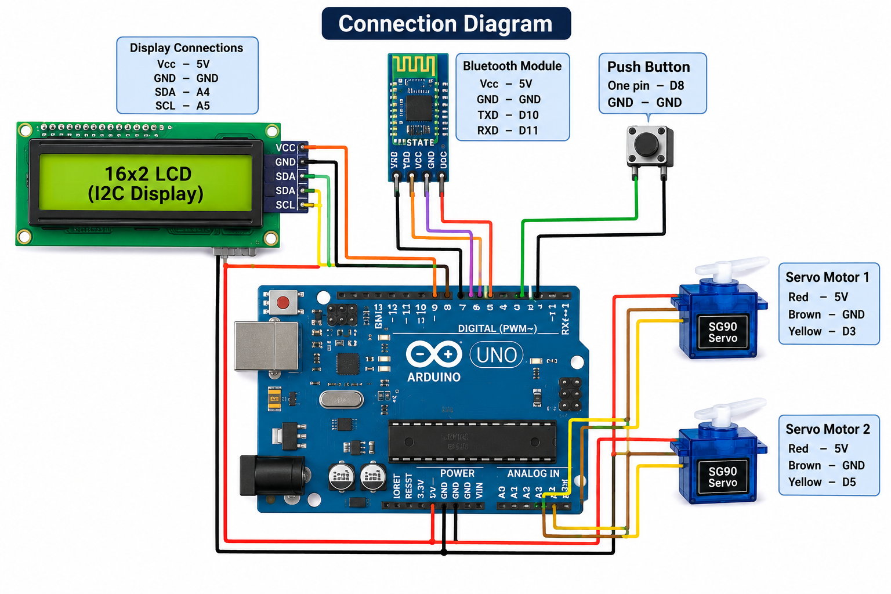

# Hybrid Voice-Controlled Safety System

## 📌 Project Overview

The Hybrid Voice-Controlled Safety System is an Arduino-based prototype designed to demonstrate remote and manual control of an electrical safety isolation mechanism.

The system combines Bluetooth voice commands with manual push-button operation to control servo-based switching mechanisms.

## 🎯 Objectives

- Develop a voice-controlled electrical safety prototype.
- Implement manual control as an alternative operating method.
- Demonstrate automated switching using Arduino.
- Explore practical applications of embedded systems in electrical safety.

## ⚙️ Components Used

- Arduino Uno
- HC-05 Bluetooth Module
- SG90 Servo Motors (2)
- 16×2 LCD Display with I2C
- Push Button
- Connecting Wires
- Power Supply

## 🔄 Working Principle

1. The Arduino Uno acts as the main controller.
2. Voice commands are transmitted through a Bluetooth-connected mobile phone using the HC-05 module.
3. Arduino processes the received commands.
4. Servo motors operate the prototype switching mechanism.
5. A manual push button provides an alternative control method.
6. The LCD displays system information.

## 🔌 Hardware Configuration

| Component | Arduino Connection |
|---|---|
| Servo Motor 1 | Digital Pin 3 |
| Servo Motor 2 | Digital Pin 5 |
| Push Button | Digital Pin 8 |
| LCD Display | I2C (SDA/SCL) |
| HC-05 | Bluetooth serial communication |

## 🏗️ Applications

- Electrical safety demonstration models
- Remote switching prototypes
- Embedded control systems
- Educational electrical automation projects

## 🛠️ Technologies Used

- Arduino Uno
- Embedded Systems
- Bluetooth Communication
- Servo Motor Control
- Hardware Interfacing

## 📷 Project Demonstration

### Circuit Diagram

### Hardware Prototype

---

## 📌 Project Status

Completed - Educational Prototype

## 👨‍💻 Developer

**Kasthuri Manvith**

[GitHub](https://github.com/Manvith103) | [LinkedIn](https://www.linkedin.com/in/manvith-kasthuri/)

## 👨‍🎓 Project Details

**Domain:** Electrical and Electronics Engineering

**Project Type:** Embedded Systems and Electrical Safety

**Developer:** Kasthuri Manvith

---

*This is an educational prototype. It is not certified for real high-voltage isolation or protection. Actual electrical isolation requires appropriately rated equipment and qualified engineering implementation.*
